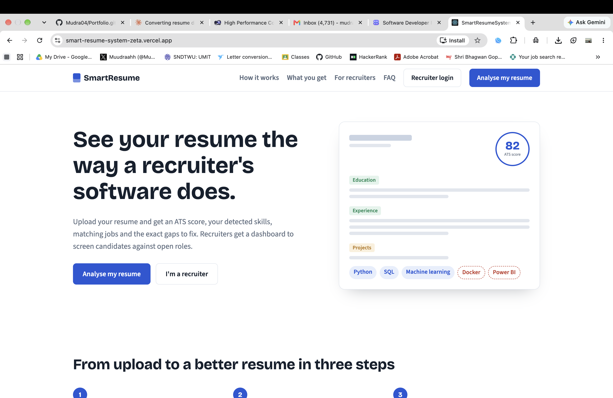
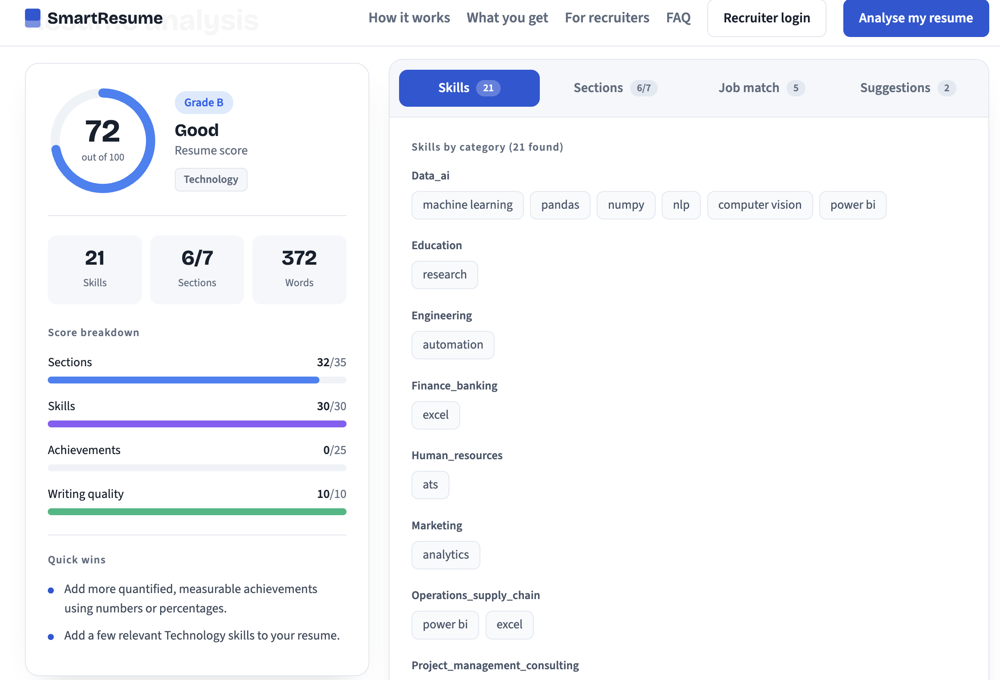
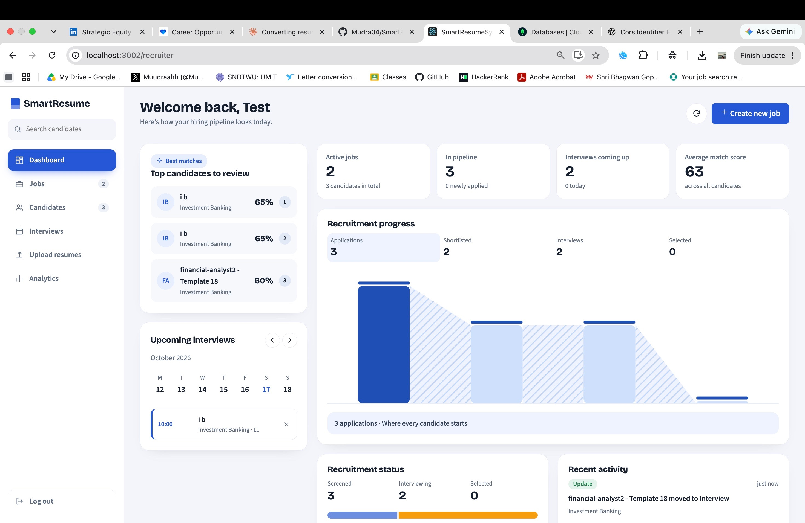
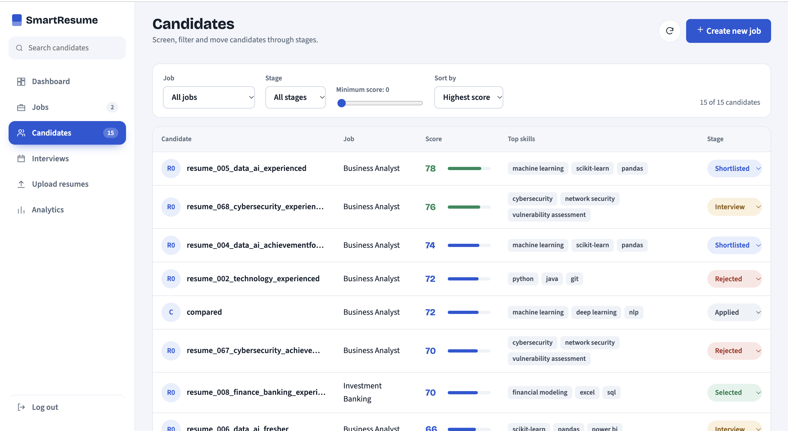

<div align="center">

# SmartResume

### Smart Resume Screening & Job Recommendation System

One platform for both sides of hiring: candidates get a clear, explained score for their resume, and recruiters get a ranked, trackable pipeline.

[](https://smart-resume-system-zeta.vercel.app)


</div>

**Live app:** https://smart-resume-system-zeta.vercel.app
**API:** https://smartresumesystem-api.onrender.com

> The backend runs on a free hosting tier. If nobody has used it for a while, the first request can take up to a minute while the server wakes up. After that it responds normally.

---

## Contents

- [Why we built this](#why-we-built-this)
- [What it does](#what-it-does)
- [How the scoring works](#how-the-scoring-works)
- [Screenshots](#screenshots)
- [Tech stack](#tech-stack)
- [Architecture](#architecture)
- [Project structure](#project-structure)
- [API overview](#api-overview)
- [Run it locally](#run-it-locally)
- [Deployment](#deployment)
- [Known limitations](#known-limitations)
- [Roadmap](#roadmap)
- [Privacy and responsible use](#privacy-and-responsible-use)
- [Team](#team)

---

## Why we built this

Every hiring team has the same problem: far more resumes than hours to read them. Reading by hand is slow and inconsistent, and candidates rarely find out why they were rejected. Most keyword-based tools produce a score but don't explain it.

We wanted to build something that helps both people in the process. A candidate should be able to upload a resume and immediately understand what is strong, what is missing and what to fix. A recruiter should be able to open one dashboard and see candidates ranked against a job, then track them from first look to final decision.

SmartResume is our answer, built as a final-year project in the Department of Data Science Engineering.

---

## What it does

### For candidates (no account needed)

Upload a PDF resume and get:

- **An ATS-style score out of 100** with a grade from A to F
- **A score breakdown** showing where points were won and lost
- **Skills detected**, grouped by category, plus **high-demand skills that are missing**
- **A section-by-section review** of seven key sections, with tips for each
- **Quantified achievements** detected, and **overused words** flagged
- **Job-role matches** ranked by match percentage, showing matched and missing skills, with a **Find on LinkedIn** shortcut for each role
- **Specific improvement suggestions**

### For recruiters (login required)

- **Secure registration and login** using token-based authentication (JWT)
- **Job management:** create, edit and delete jobs with title, company, description, required skills, experience and domain
- **Bulk resume upload** to a job: every resume is parsed, scored and matched automatically
- **Candidate list** with search and filters (job, hiring stage, minimum score) and sorting
- **Candidate profile panel** showing score, matched and missing skills and details
- **Hiring stages:** Applied, Screening, Shortlisted, Interview, Selected, Rejected
- **Dashboard** with live counts, top candidates, a recruitment progress funnel, a status bar and a recent-activity feed
- **Interview calendar** with a week view and an upcoming-interviews list
- **Analytics page:** score distribution, candidates by stage, candidates per job and most common skills

---

## How the scoring works

The score is deliberately **transparent and rule-based**, so a candidate can see exactly why they got their result and a recruiter can trust it.

| Component | Points | What it looks at |
|---|---|---|
| Sections | 35 | Which of the 7 key sections are present (summary, education, experience, projects, skills, certifications, achievements) |
| Skills | 30 | Relevant skills detected, weighted for the resume's domain |
| Achievements | 25 | Quantified results such as percentages, amounts and counts |
| Writing quality | 10 | Variety of language and overused words |

**Grades:** A (85+), B (70+), C (55+), D (40+), F (below 40).

Job matching compares the skills found in a resume with the required skills of predefined job profiles, and reports a match percentage together with matched and missing skills.

---

## Screenshots

> Add your screenshots to `docs/screenshots/` using these file names, and they will appear here.

| Home page | Resume analysis |
|---|---|
|  |  |

| Recruiter dashboard | Candidates |
|---|---|
|  |  |

---

## Tech stack

| Layer | Technology |
|---|---|
| Frontend | React, React Router, custom CSS |
| Backend | Python, Flask, Flask-CORS, Flask-JWT-Extended |
| Database | MongoDB Atlas (PyMongo) |
| PDF parsing | pdfplumber |
| Authentication | JWT access tokens, hashed passwords (Werkzeug) |
| Hosting | Vercel (frontend), Render (backend), MongoDB Atlas (database) |

---

## Architecture

```
 Candidate / Recruiter
          |
          v
  React frontend  (Vercel)
          |   HTTPS + JSON
          v
  Flask REST API  (Render)  -- JWT-protected recruiter routes
      |            |
      v            v
 Analysis engine   MongoDB Atlas
 (parser, skills,  (users, jobs,
  scoring, jobs)    candidates)
```

---

## Project structure

```
SmartResumeSystem/
├── backend/
│   ├── app.py                       # Flask app and API routes
│   ├── resume_parser.py             # PDF text extraction and parsing
│   ├── skills.py                    # Skills knowledge base
│   ├── job_matcher.py               # Job-role matching
│   ├── career_paths.py
│   ├── courses.py
│   ├── candidate_status_routes.py   # Hiring-stage update route
│   └── requirements.txt
└── frontend/
    ├── vercel.json                  # Lets deep links work on refresh
    └── src/
        ├── api.js                   # API address and token helpers
        ├── App.js                   # Routes
        ├── pages/                   # Landing, Analyser, Recruiter login and dashboard
        ├── components/              # Shared and recruiter UI components
        └── styles/
```

---

## API overview

| Method | Endpoint | Auth | Purpose |
|---|---|---|---|
| GET | `/` | No | Health check |
| POST | `/analyze_resume` | No | Analyse an uploaded PDF (form field `resume`) |
| POST | `/register` | No | Create a recruiter account |
| POST | `/login` | No | Log in and receive an access token |
| POST | `/jobs` | Yes | Create a job |
| GET | `/jobs` | Yes | List your jobs |
| PUT | `/jobs/<job_id>` | Yes | Update a job |
| DELETE | `/jobs/<job_id>` | Yes | Delete a job |
| POST | `/jobs/<job_id>/candidates` | Yes | Upload a resume to a job; it is scored and stored |
| GET | `/jobs/<job_id>/candidates` | Yes | List a job's candidates |
| PUT | `/candidates/<candidate_id>/status` | Yes | Move a candidate to a hiring stage |

Protected routes expect the header `Authorization: Bearer <token>`.

---

## Run it locally

**You will need:** Python 3.10 or newer, Node.js 18 or newer, and a free [MongoDB Atlas](https://www.mongodb.com/atlas) cluster.

### 1. Clone

```bash
git clone https://github.com/Mudra04/SmartResumeSystem.git
cd SmartResumeSystem
```

### 2. Backend

```bash
cd backend
python3 -m venv venv
source venv/bin/activate          # on Windows: venv\Scripts\activate
pip install -r requirements.txt
```

Create a file named `.env` inside `backend/`:

```env
MONGO_URI=your-mongodb-atlas-connection-string
JWT_SECRET_KEY=a-long-random-string
```

Start the API:

```bash
python3 app.py
```

It runs at `http://localhost:5001`. In MongoDB Atlas, make sure your IP address is allowed under **Network Access**.

### 3. Frontend

In a second terminal:

```bash
cd frontend
npm install
npm start
```

The app opens at `http://localhost:3000`. By default it talks to `http://localhost:5001`. To point it somewhere else, create `frontend/.env`:

```env
REACT_APP_API_URL=http://localhost:5001
```

### Environment variables

| Variable | Where | Purpose |
|---|---|---|
| `MONGO_URI` | backend | MongoDB Atlas connection string |
| `JWT_SECRET_KEY` | backend | Secret used to sign login tokens |
| `FRONTEND_ORIGINS` | backend (optional) | Comma-separated list of website addresses allowed to call the API. Allows all if not set |
| `REACT_APP_API_URL` | frontend | Address of the backend API |

Never commit `.env` files. They are listed in `.gitignore`.

---

## Deployment

The live version uses free tiers of three services.

**Backend on Render**
- Root directory: `backend`
- Build command: `pip install -r requirements.txt`
- Start command: `gunicorn app:app`
- Environment variables: `MONGO_URI`, `JWT_SECRET_KEY`, `PYTHON_VERSION`, and `FRONTEND_ORIGINS` set to the frontend's address

**Frontend on Vercel**
- Root directory: `frontend`
- Environment variable: `REACT_APP_API_URL` set to the Render address
- `frontend/vercel.json` rewrites every path to `index.html`, so pages such as `/analyser` still load when refreshed

**Database on MongoDB Atlas**
- Network Access allows connections from the hosting provider

Pushing to the main branch redeploys both the frontend and the backend automatically.

---

## Known limitations

We would rather be upfront about these:

- **Scoring is rule-based, not machine learning.** It is consistent and explainable, but it relies on a predefined knowledge base of skills and roles, and it can miss skills that are not in it.
- **PDF resumes only.** Scanned or image-only PDFs may not extract well.
- **The interview calendar and activity feed are saved in the browser,** not the database, so they do not follow a recruiter to another device.
- **Free hosting sleeps when idle,** so the first request after a quiet period is slow.
- **No formal accuracy study yet.** We have tested on sample resumes, but we have not yet compared the scores with ratings from human experts.

---

## Roadmap

- Semantic skill and job matching using machine-learning models
- A larger evaluation dataset and a comparison against human ratings
- Server-side interview scheduling and email notifications
- Support for DOCX resumes
- A fairness and bias review of the scoring rules
- Candidate accounts to save and compare multiple resume versions

---

## Privacy and responsible use

Resumes contain personal information. This project is a student demo, so please do not upload real, sensitive resumes to the public deployment. The scoring looks at resume structure, skills, achievements and writing, and is meant to support a recruiter's judgement, not replace it. A production version would need consent handling, encryption of stored files and a data-retention policy.

---

## Team

Built by a team of three final-year students at the Department of Data Science Engineering, Usha Mittal Institute of Technology, S.N.D.T. Women's University, Mumbai:

- **Mudra Berde**
- **Disha Waghvale**
- **Neeti Bole**

This is an academic project. All rights are reserved by the authors unless a `LICENSE` file in this repository says otherwise.
